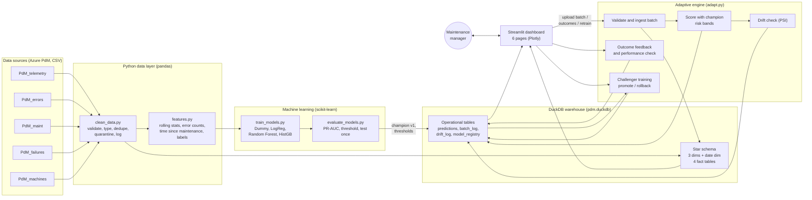
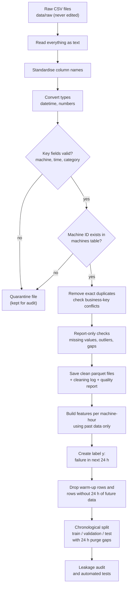
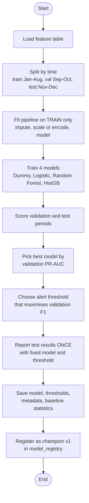
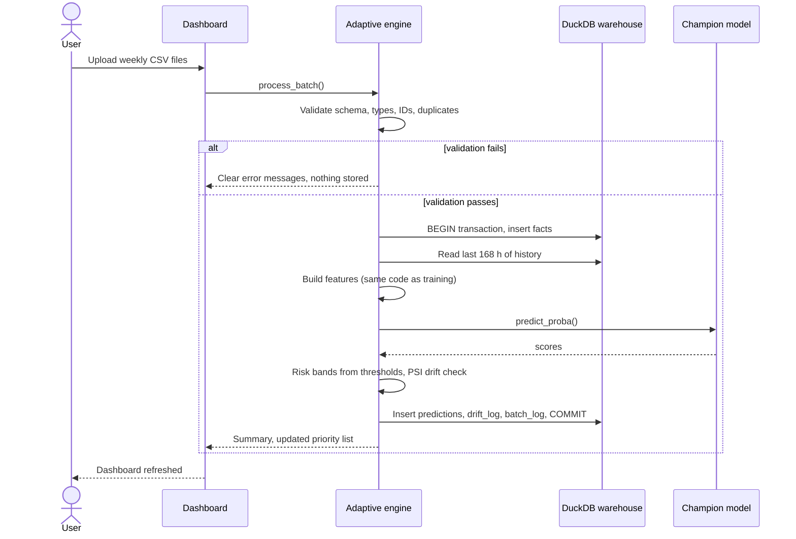
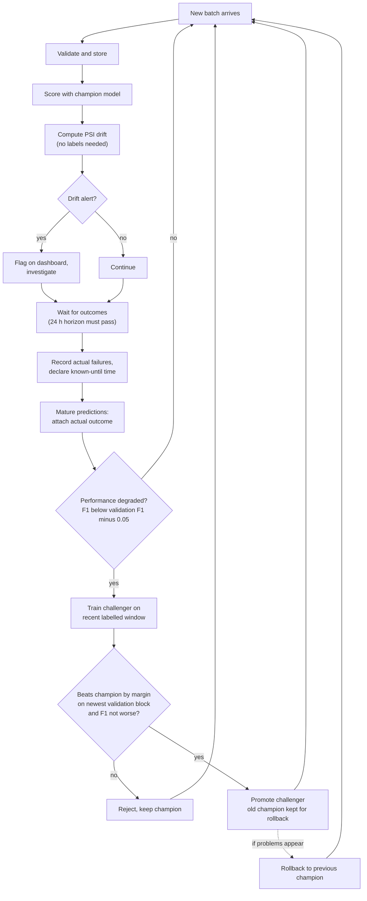
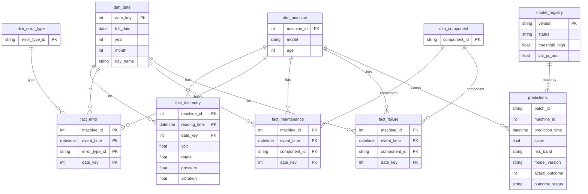
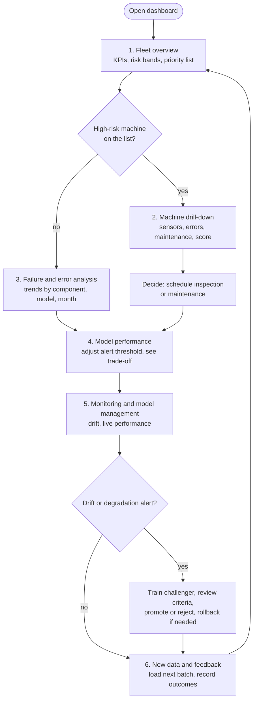
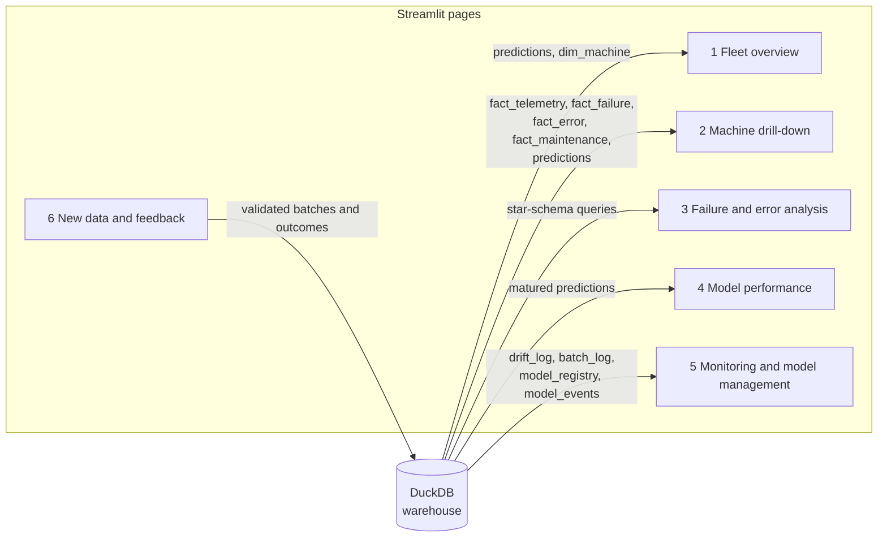

# Diagrams for the report (all match the code that was actually built)

How to use: open https://mermaid.live , paste ONE diagram's code (without the triple backticks), then
**Actions → PNG** (or SVG) and insert the image in your report. Use 2x or 3x scale for sharp text.

---

## Figure A. System architecture

---

## Figure B. Data cleaning and feature-engineering workflow

---

## Figure C. Program flow chart: model training and evaluation

---

## Figure D. Batch prediction workflow

---

## Figure E. Adaptive feedback loop

---

## Figure F. Warehouse schema (star schema plus operational tables)

---

## Figure G. User flow chart (dashboard)

---

## Figure H. Dashboard page map

